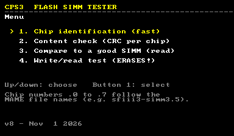
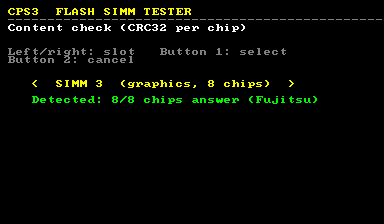
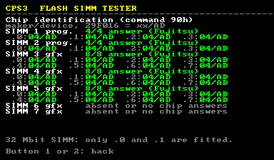
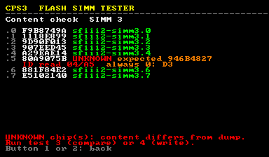
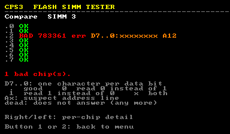
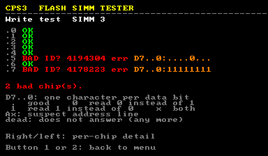
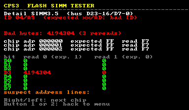

# CPS3 SIMM Tester

A replacement cartridge BIOS for Capcom CPS3 boards that does only one thing:
it tests the flash SIMMs, both program and graphics, and tells you
**which chip** is faulty, **which data bits** are wrong and **which address
line** looks suspicious, with the first failing addresses.

It is meant for repairing SIMMs. A graphics SIMM has 8 flash chips and a
program SIMM has 4. This tool tells you which one to replace.

> **Authorship.** This BIOS, its tools and this documentation were written by
> **Claude**, Anthropic's AI model, for **aje_fr**, who tested it on real
> CPS3 hardware.



---

## Contents

1. [Which file to flash](#1-which-file-to-flash)
2. [Before you start](#2-before-you-start)
3. [Controls](#3-controls)
4. [The four tests](#4-the-four-tests)
5. [Reading the results](#5-reading-the-results)
6. [Chip numbering](#6-chip-numbering)
7. [How it works](#7-how-it-works)
8. [Building from source](#8-building-from-source)
9. [Testing in MAME](#9-testing-in-mame)
10. [Status and limitations](#10-status-and-limitations)
11. [Version history](#11-version-history)

---

## 1. Which file to flash

The BIOS goes into the 29F400 flash (TSOP48, `U2`) of the security
cartridge, in place of the game BIOS.

| Cartridge | File |
|---|---|
| Dead cartridge (dead battery, key erased) or *SF III 2nd Impact* cartridge | [`bios/simmtest_en_dead_cart.bin`](bios/simmtest_en_dead_cart.bin) |
| Cartridge whose custom SH-2 was replaced by a standard SH-2 (HD6417095) | [`bios/simmtest_en_sh2_standard.bin`](bios/simmtest_en_sh2_standard.bin) |

- **Dead cartridge.** When the battery dies, the decryption key is erased
  and the cartridge decrypts with a zero key, the same key as *2nd Impact*.
  The dead-cart file is encrypted with that zero key.
- **Standard SH-2.** A standard SH-2 has no decryption at all. This file is
  not encrypted. The few constants the BIOS reads by DMA stay raw, exactly
  as in the original.

**Keep a dump** of your cartridge's original 29F400 before you reprogram it,
so that you can put the game BIOS back afterwards.

## 2. Before you start

- Insert the SIMMs to test in their slots. Slots 1 and 2 take program SIMMs,
  slots 3 to 7 take graphics SIMMs.
- No CD-ROM drive or SCSI setup is needed.
- On first use, run tests 1 and 2 on a SIMM you know is good. They are
  read-only, so this is risk-free and checks that your setup works.

## 3. Controls

| Input | Action |
|---|---|
| Joystick up/down | Choose a menu entry |
| Joystick left/right | Choose a slot. On a results screen, page through the per-chip details |
| Button 1 | Select |
| Button 2 | Back / cancel |
| Button 3 | Confirm the destructive write test |
| Buttons 2 + 3 together | Abort a running write test |

## 4. The four tests

Tests 2, 3 and 4 first ask which slot to test. As you move from slot to
slot, the screen says whether a SIMM is detected there: how many chips
answer the identification command, and their manufacturer.



A graphics SIMM is recognised as a **32 Mbit SIMM** when chip `.0` or `.1`
answers and positions `.2` to `.7` all read the same empty-bus value. Tests
2, 3 and 4 then cover only chips `.0` and `.1`, so positions that are not
fitted are not reported as faulty. A failing `.0` or `.1` chip does not
prevent this detection.

### 1. Chip identification (fast, read-only)

The BIOS sends the standard *autoselect* command (90h) to every chip of
every slot and shows the manufacturer and device code of each one.



- A healthy 29F016 answers `xx/AD`. The first byte is the manufacturer:
  `04` Fujitsu, `01` AMD, `20` ST, `C2` Macronix, and so on.
- Some SIMMs use Intel/Sharp-type 28F016 chips instead, such as the Hitachi
  HN98F1600. They answer `89/A0` (Intel) or `B0/88` (Sharp). Like the
  original BIOS, this BIOS tries the Intel identification command when no
  chip answers `xx/AD`, and then uses the Intel command set for that SIMM.
- `FF/FF` means the chip does not answer. Look for a dead chip, a missing
  supply, a broken CE or WE line, or a bad solder joint.
- A wrong ID such as `04/A5` often means a data bit is stuck. In that
  example, D3 of the device code reads 0.
- 32 Mbit (4 MB) graphics SIMMs, such as the ones holding sound data,
  only have chips `.0` and `.1` fitted. The BIOS shows them as `32 Mbit`.

### 2. Content check: CRC32 per chip (read-only, about 20 s per graphics SIMM)

The BIOS reads every chip and computes its CRC32. It compares each CRC with
the **209 chip dumps** of the MAME CPS3 sets, all games and all revisions.



- A recognised chip shows its MAME file name, for example `sfiii3-simm3.5`.
- If the other chips of the SIMM are recognised, an unrecognised chip shows
  `UNKNOWN expected xxxxxxxx`, the CRC it should have had.
- The BIOS also reports hardware hints:
  - `always 0: Dn` or `always 1: Dn` is a data bit that never changes over
    the whole chip.
  - `A12?` is an address line that seems to have no effect.
  - `ID read xx/yy` is a chip that gave an unexpected identification.

### 3. Compare to a good SIMM (read-only)

Put a good SIMM of the **same game** in another slot of the same type:
1 or 2 for program SIMMs, any of 3 to 7 for graphics SIMMs. The BIOS then
compares the two SIMMs byte by byte. It is the most precise test that does
not erase anything.



For each chip you get:
- the number of wrong bytes;
- the first three wrong addresses, with the expected and the read value;
- the error count for each data bit;
- the suspect address line, if any.

### 4. Write/read test (ERASES the SIMM)

This test needs a confirmation with button 3. It then runs these steps:

1. Erase the chips.
2. Check that every byte reads `FF`.
3. Write a pattern that depends on every address bit.
4. Read the pattern back.
5. Erase, write the inverse pattern, and read it back.
6. Erase again.

While the test runs, the per-chip summary (error count, wrong data bits,
suspect address lines) is shown and updated live, so a failing chip shows
up before the six steps are over.

Every bit of every byte is thus tested at both 0 and 1. A failing erase or
program operation is detected through the chip's own status bits: DQ6
toggle, and DQ5 for a timeout.



**The SIMM is left blank.** You have to reprogram it afterwards, for
example from the game CD.

In MAME the test takes about 5 minutes for a program SIMM and about
10 minutes for a graphics SIMM. On real hardware, expect it to take longer.

## 5. Reading the results

Each chip gets one line:

```
.5 BAD 4194304 err D7..0:....0... A12
```

| Field | Meaning |
|---|---|
| `.0` … `.7` | Chip number, in **MAME file order**. `sfiii3-simm3.5` is chip `.5` of SIMM 3 |
| `OK` / `BAD` | Verdict |
| `BAD dead` | The chip stopped answering during the test (timeout) |
| `ID?` | The chip does not return a 29F016 ID, often because of a bad data bit |
| `N err` | Number of wrong bytes (out of 2,097,152 per chip) |
| `D7..0:` | One character per data bit of the chip, D7 on the left: `.` good, `0` read 0 instead of 1, `1` read 1 instead of 0, `x` both |
| `A12` | Suspect address line, as seen by the chip. The byte read is the one at the neighbouring address that differs only by this bit |

Press right/left to open the **detail page** of each chip:



### Typical faults (checked in MAME with injected faults)

| Fault | What you see |
|---|---|
| D3 of chip .5 stuck at 0 | `.5 BAD … D7..0:....0...`. The detail page shows every error on D3 |
| D5 of chip .2 stuck at 1 | `.2 BAD … D7..0:..1.....` |
| A12 of chip .2 open | `.2 BAD … D7..0:xxxxxxxx A12` |
| Chip .7 not answering | Identification `FF/FF`, then `.7 BAD ID? … D7..0:11111111` |

## 6. Chip numbering

The BIOS identifies a chip by its position on the data bus.

| SIMM | Chip → board data lines |
|---|---|
| Program (slots 1–2) | `.0` = D31–24, `.1` = D23–16, `.2` = D15–8, `.3` = D7–0 |
| Graphics (slots 3–7) | Chips are read in pairs (`.0/.1`, `.2/.3`, `.4/.5`, `.6/.7`). The even chip carries D31–24 and D15–8, the odd chip D23–16 and D7–0 |

The silkscreen reference (U1, U2…) of each chip number is not mapped yet.
You can find it once with a multimeter, from a chip DQ pin to the SIMM
connector. You can also use a SIMM where you have already replaced one chip
with another brand: test 1 shows its position.

## 7. How it works

The BIOS contains **no Capcom code**. It starts with its own boot code
(`boot.S`), followed by a C program compiled for the SH-2 at `0x2000`.

The boot code performs the same register writes, in the same order, as the
boot of an original cartridge BIOS. The write sequence was recorded with
MAME and checked against the original, write by write:

1. With the cache off, a short routine is copied into the SH-2 cache
   (`0xC0000000`, tags `0x410` at `0x40000000`) and run from there. It
   writes `0xBD0F` to `0xFFFFFE80` and `0x0002` to `0xFFFFFE90`.
2. The bus is configured (BCR1 `0x0020`, BCR2 `0x00E8`, WCR `0xAA57`), then
   the cache is enabled.
3. DMA channel 0 copies 3 raw words from `0x1FF00` to `0x27FF0000`. This
   configures the security chip.
4. `hw_init()` in `simmtest.c` writes the I/O and video registers listed in
   `hw_tab.h`, acknowledges the interrupts, waits 300 ms, then clears the
   video memories.

The cache routine and the code are encrypted like any cartridge BIOS. The
constants read by DMA (`0x1FF00–0x1FF6B`) stay raw, as in the original.

The flash access sequences were recorded with MAME from the original
`sfiii3_euro` BIOS while it reflashed the SIMMs from the *3rd Strike* CD.
They are reproduced exactly:

- **Security gating.** Before any flash command, `0x01050003` is written to
  `0x07FF000C`, and `0x01050000` at the end. For graphics SIMMs, `0x07FF0048`
  is set to 1 during each write. Like the original, these values are copied
  by DMA from raw constants stored in the BIOS at `0x1FF0C–0x1FF37`.
- **Program SIMMs (slots 1–2).** Commands, data and reads all go through
  SH-2 DMA channel 0, which bypasses the cartridge decryption. The command
  addresses are `+0x1554` and `+0xAA8`, 32 bits wide, so the 4 chips are
  addressed in parallel.
- **Graphics SIMMs (slots 3–7).** The CPU writes 16 bits at a time into the
  window at `0x04200000`. The bank is selected at `0x040C0088` with
  `(simm-3)*8 + pair*2 + half + 2`. Status polling uses **16-bit reads**: a
  32-bit read hits each chip twice, so DQ6 never seems to toggle.
- **Completion.** The end of an operation is detected with the DQ6 toggle
  bit, and a timeout with DQ5.
- **Intel/Sharp-type chips (28F016).** The sequences come from the original
  BIOS: `90` to read the ID, `50` then `FF` to clear the status and return
  to read mode, `A7`/`D0` to erase the whole chip, with the extended status
  `71` polled for readiness, and `40` + data to program, then status `70`
  (bit 7 = ready, bit 4 = program error, bit 5 = erase error). On program
  SIMMs these command words are sent by DMA from raw constants at
  `0x1FF40–0x1FF6B`, like the original.
- **Display.** Text uses the CPS3 text layer (the "SS" layer), with a
  public-domain 8×8 font.

Some video initialisation steps matter on real boards but are invisible in
MAME:
- The palette, the text-layer RAM and the sprite RAM power up with random
  content, so the BIOS clears them all.
- Right after power-up, many of those writes are lost. On a test board,
  more than 55,000 palette writes did not stick. The BIOS therefore waits
  300 ms after power-up. It then reads every cleared word back and writes it
  again until it holds, for the palette, the sprite RAM and every byte of
  the text layer. The palette is checked again each time the menu is drawn.
- After setting the CRT timings, the BIOS writes `0x0063` to the video
  control register `0x040C0080`, as the original BIOS does. Without that
  write, text is garbled on a real board.

## 8. Building from source

Everything is in [`source/`](source/). The comments in the source code are
in French.

| File | Role |
|---|---|
| `simmtest.c` | The test program |
| `boot.S` | Boot code: cache routine, bus setup, security chip DMA, raw DMA constants (`0x1FF00–0x1FF6B`) |
| `hw_tab.h` | I/O and video register writes done at boot |
| `crt0.S`, `link.ld` | C runtime startup and link script |
| `link_capcom.ld` | Only for the optional `--base` mode, which reuses the boot of a BIOS dump you provide |
| `construire_bios.py` | Build script: compiles, assembles the BIOS image and encrypts it |
| `traduire_en.py` | Produces the English text version (`--lang en`) |
| `refs_mame.h` | CRC32 list of the MAME CPS3 chip dumps |
| `font8x8_*.h` | Public-domain 8×8 font |
| `banc_mame_drive.lua` | MAME Lua script used to drive the tests and inject faults |

You need:
- an `sh-elf-gcc` cross compiler targeting SH-2 (`-m2`), with its libgcc;
- `sh-elf` binutils;
- Python 3.

No original BIOS dump is needed.

```sh
# dead cartridge (key 0/0)
python3 construire_bios.py --lang en --key dead --out simmtest_en_dead_cart.bin

# standard SH-2 (no encryption)
python3 construire_bios.py --lang en --key none --out simmtest_en_sh2_standard.bin
```

These commands rebuild the two files in `bios/` byte for byte.

Other options:
- `--key` also accepts the game keys (`sfiii`, `sfiii3`, `jojo`, `jojoba`,
  `redearth`), or `k1,k2` in hex, for a cartridge whose key is still alive.
- `--dumps <folder>` adds your own 2 MB chip dumps to the list of contents
  that test 2 recognises.
- Without `--lang en`, the texts are in French.

## 9. Testing in MAME

- **Dead-cart BIOS.** Rename it `sfiii2_asia_nocd.29f400.u2` in the
  `sfiii2n` set and ignore the checksum warning.
- **Standard SH-2 BIOS.** Use the `cps3boot` driver, which emulates a board
  with a standard SH-2. Rename the BIOS
  `no-battery_bios_29f400_for_hd6417095_sh2.u2`. The SIMM contents are read
  from the nvram folder (`simm1.0` … `simm7.7`).

`banc_mame_drive.lua` navigates the menus, saves each screen as text and
injects faults on flash reads: stuck data bits, open address lines and
silent chips. It can also randomise the video RAM at power-up and corrupt
writes to the text layer.

## 10. Status and limitations

- **Real hardware:**
  - the boot and the display work, with a clean black background;
  - the read tests on a good program SIMM work.
- **Validated in MAME only, with injected faults:**
  - graphics SIMMs;
  - the destructive write test;
  - the fault reports.

  Reports from real faulty SIMMs are welcome.
- Intel/Sharp-type chips: MAME does not emulate them on CPS3. Their
  detection was checked in MAME with simulated chips. Their erase and
  program sequences follow the original BIOS but have not been run yet.
- A graphics SIMM is read in pairs of chips. A fault shared by a pair, such
  as the bank select or a shared line, shows on both chips.
- The address line number is the one seen by the chip. This assumes that
  the SIMM does not swap address lines.
- The binaries contain no Capcom code. The register values written at boot
  and the raw constants read by DMA (security chip setup, flash command
  bytes) are hardware settings that were recorded from the original boot.

## 11. Version history

| Version | Change |
|---|---|
| v1–v5 | Development versions, built on the boot code of an original cartridge BIOS. Fixed the display on real hardware |
| v6 | Own boot code: the BIOS no longer contains any Capcom code. Slot selection shows whether a SIMM is detected |
| v7 | Waits after power-up before clearing the video memories |
| v8 | Reads back and rewrites the palette and sprite RAM until they are cleared. **Clean black background on real hardware** |
| v9 | Recognises 32 Mbit graphics SIMMs (chips `.0` and `.1` only) and tests only the fitted chips |
| v10 | Supports Intel/Sharp-type 28F016 chips (e.g. Hitachi HN98F1600): identification, read tests and write test |
| v11 | The write test shows the per-chip error summary live, during the six steps |

---

*Written by Claude (Anthropic) for aje_fr.*
